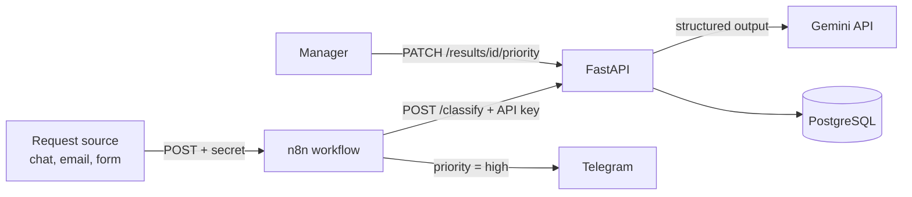

# Request Classifier: AI request processing (FastAPI + PostgreSQL + n8n + AWS)

🇺🇦 [Українська версія](README.uk.md)

A Python service that takes free-form requests, classifies each one with an LLM (Gemini) into a strict
structure, stores the result in PostgreSQL, and alerts a manager in Telegram when a request is urgent.
A human can always override the priority set by the AI, and the service tracks how often that happens.

The project grew from a Netpeak AI Solutions test task into a full service:
CLI → tests and CI → AWS Lambda → asyncio → Telegram and Google Sheets → FastAPI → PostgreSQL →
Docker Compose → n8n.

## Features

- Returns structured JSON: category, department, priority (`low` / `medium` / `high`), short summary,
  requested actions, and a "needs clarification" flag.
- Three ways to run: **HTTP API** (FastAPI), **batch CSV processing** (`python main.py`), and
  **serverless on AWS** (S3 → Lambda → S3).
- Stores results in PostgreSQL.
- **Human-in-the-loop:** a manager changes the priority through the API. The AI value is never
  overwritten, and the change is recorded (who and when). `GET /stats/overrides` shows how often
  humans disagree with the AI.
- **Automation in n8n:** webhook → classify → if `high` → Telegram message.
- Parallel processing (asyncio), a registry in Google Sheets, retries with exponential backoff.

## Architecture



Docker Compose runs three services: `db` (PostgreSQL 16), `api` (FastAPI), and `n8n`.
All ports are bound to `127.0.0.1` only.

## Quick start (Docker Compose)

1. Copy `.env.example` to `.env` and fill in:
   - `GEMINI_API_KEY`: a free key from [aistudio.google.com/apikey](https://aistudio.google.com/apikey)
   - `POSTGRES_PASSWORD`: database password
   - `API_KEY`: a long random string that protects the API
   - `N8N_ENCRYPTION_KEY`: a random string (keep a backup, n8n credentials cannot be recovered without it)
   - `N8N_VERSION`: n8n version (for example `2.47.3`)

   Random string: `python -c "import secrets; print(secrets.token_urlsafe(32))"`

2. Start everything:

   ```bash
   docker compose up -d --build
   ```

3. API and docs: <http://127.0.0.1:8000/docs>. Protected endpoints need the `X-API-Key` header.
4. n8n: <http://127.0.0.1:5678>. Import `n8n/workflows/classify-and-alert.json` and create credentials:
   Header Auth for the API (`X-API-Key`), Header Auth for the webhook (`X-Webhook-Secret`),
   and a Telegram bot credential.

## API

| Method | Path | Description |
|---|---|---|
| GET | `/health` | Health check (no key needed) |
| POST | `/classify` | Classify a request and save it. Returns the analysis and `record_id` |
| GET | `/results/{id}` | Get a saved result (includes `effective_priority`) |
| PATCH | `/results/{id}/priority` | Manager changes the priority (audit: who, when) |
| GET | `/stats/overrides` | How many results were reviewed and changed (disagreement rate) |

All endpoints except `/health` require `X-API-Key`. If `API_KEY` is not set on the server,
protected endpoints are closed (fail-closed).

```bash
curl -X POST http://127.0.0.1:8000/classify \
  -H "X-API-Key: $API_KEY" -H "Content-Type: application/json" \
  -d '{"id": "REQ-1", "text": "The report export is broken, please fix it today", "channel": "Slack"}'
```

## Automation (n8n)

Workflow `n8n/workflows/classify-and-alert.json`:

```
Webhook ──► HTTP Request (POST /classify) ──► IF priority = high ──true──► Telegram
```

- The webhook is protected by a secret in the `X-Webhook-Secret` header.
- n8n calls the API by its internal address `http://api:8000` (containers reach each other by service name).
- The n8n version is pinned (not `latest`), so an update cannot silently break workflows.

## Design note: human priority override

- The AI value (`priority`) is never overwritten. The manager's decision goes to `priority_override`,
  while `overridden_by` and `overridden_at` record who and when.
- Effective priority: `COALESCE(priority_override, priority)`. Statistics for `high` use it.
- The disagreement rate (`changed / reviewed`) is feedback for improving the prompt.
- Migration: `ALTER TABLE ... ADD COLUMN IF NOT EXISTS`, so an existing database is upgraded without data loss.

## Batch CSV processing

```bash
pip install -r requirements.txt
python main.py
```

The script reads `input_requests.csv`, processes every request, and creates:
- `output.json`: the full structured result
- `report.md`: a short report with aggregates

If `DATABASE_URL` is set, results are also saved to PostgreSQL, and an SQL statistics section is
appended to `report.md`.

### Run in Docker (without Compose)

```bash
docker build -t request-classifier .
docker run --rm --env-file .env -v "$PWD/data:/data" request-classifier
```

(in PowerShell use `${PWD}` instead of `$PWD`). Put `input_requests.csv` into `data/`; the container
writes results there. Secrets are passed with `--env-file` and never end up in the image
(`.env` is excluded by `.dockerignore`).

## Database (PostgreSQL)

```
runs(id, source_file, started_at, total, failed)
  └──< results(id, run_id → runs.id, request_id, channel, category,
               target_department, priority, short_summary, requested_actions (JSONB),
               needs_clarification, processing_status,
               priority_override, overridden_by, overridden_at)
```

- One processing run is saved in **one transaction**: all rows or nothing.
- Constraints: `FOREIGN KEY`, and `CHECK` for `priority`, `priority_override`, `processing_status`.
- Queries are parameterized (`%s`), never built by string concatenation.
- Sample SQL for practice: [`queries.sql`](queries.sql).

## Deploy on AWS (serverless pipeline)

```
CSV  ──►  S3 (input)  ──event .csv──►  Lambda  ──►  Gemini API
                                          │
                                          ▼
                              S3 (output): results/<name>_output.json
                                           results/<name>_report.md
```

Uploading a `*.csv` file to the input bucket triggers the Lambda function (`lambda_handler.py`,
Python 3.13). It runs the same logic as `main.py` and writes `*_output.json` and `*_report.md`
to the output bucket.

| Component | Setup |
|---|---|
| **S3** | two buckets: input and output |
| **Event notification** | `s3:ObjectCreated:Put/Post` with suffix filter `.csv` → Lambda |
| **Lambda** | Python 3.13, x86_64, handler `lambda_handler.lambda_handler`, larger timeout and memory |
| **Environment variables** | `GEMINI_API_KEY`, `OUTPUT_BUCKET`; optional `MAX_CONCURRENCY`, `MAX_REQUESTS_PER_MINUTE`, `TELEGRAM_*`, `GOOGLE_*` |
| **IAM role** | least privilege: `s3:GetObject` / `s3:ListBucket` on input, `s3:PutObject` on output, CloudWatch logs |
| **Logs** | CloudWatch Logs |

### Build the Lambda package

Install dependencies for Linux, even if you develop on Windows:

```bash
pip install -r requirements.txt --target package \
    --platform manylinux2014_x86_64 --only-binary=:all: \
    --python-version 3.13 --implementation cp
```

Copy `main.py`, `classifier.py`, `schema.py`, `lambda_handler.py`, `sheets_logger.py`,
`telegram_notifier.py`, and `db.py` into `package/` (`main.py` imports `db`). Zip the **contents**
of the folder into `deployment.zip` and upload it to Lambda. `DATABASE_URL` is not set in Lambda,
so database writes are disabled there.

### Common problems

- **Lambda does not start after an upload:** check the suffix filter in Event notifications.
  An extra space (`" .csv"`) disables the trigger without any error. Check with
  `aws s3api get-bucket-notification-configuration`.
- **`API_KEY_INVALID`:** the key in `GEMINI_API_KEY` was entered incorrectly.
- **`No module named ...` / `_cffi_backend`:** the package was built for Windows, not Linux.
- **No log group in CloudWatch:** the function has not been invoked yet.

> In production the key should be stored in AWS Secrets Manager, not in an environment variable.

## Parallel processing (asyncio)

`process_all_async()` runs requests with `asyncio.gather`, and a `Semaphore` limits concurrent LLM
calls. The blocking `classify_request()` runs in threads (`asyncio.to_thread`). Result order matches
the CSV order.

| Variable | Default | Purpose |
|---|---|---|
| `MAX_CONCURRENCY` | `3` | how many requests to Gemini run at once |
| `MAX_REQUESTS_PER_MINUTE` | no limit | spreads request starts evenly; `12` fits the free tier (~15 RPM) |

On a critical authorization error new requests are not started, and already processed results are kept.

## Telegram notifications (batch mode)

After processing, `telegram_notifier.py` sends a summary and per-department lists
(🔴 high, 🟡 medium, 🟢 low, ⚠️ failed, ❓ needs clarification). Works locally and in Lambda.

| Variable | Required | Purpose |
|---|---|---|
| `TELEGRAM_BOT_TOKEN` | yes | bot token from @BotFather |
| `TELEGRAM_CHAT_ID` | yes | main chat |
| `TELEGRAM_DEPARTMENT_CHATS` | no | JSON `{"marketing": "-100123"}`: a separate chat per department |

If the token or chat is missing, notifications are skipped silently. A Telegram failure never breaks
processing, and the token never appears in logs. Only the standard library (`urllib`) is used.

## Google Sheets registry

Every request is appended as a row to a Google Sheet (`sheets_logger.py`): time, file, id, channel,
category, department, priority, summary, actions, flags, and a "Work status" column.

- **Option 1: Google Apps Script** (no Google Cloud, no keys). The script
  [`apps_script/Code.js`](apps_script/Code.js) is published as a web app and checks a secret token.
  Variables: `GOOGLE_APPS_SCRIPT_URL`, `GOOGLE_APPS_SCRIPT_TOKEN`, `GOOGLE_SHEET_TAB`.
- **Option 2: Google Sheets API** (service account). Variables: `GOOGLE_SHEET_ID`,
  `GOOGLE_SERVICE_ACCOUNT_JSON` or `GOOGLE_SERVICE_ACCOUNT_FILE`, `GOOGLE_SHEET_TAB`.

The URL and token are secrets, never commit them. If writing is not configured or Google returns an
error, the pipeline keeps working. The total size of Lambda environment variables is limited to 4 KB,
and a JSON key takes about 2.5 KB.

## Tests and CI

```bash
python -m pytest -v
```

The project has **133 automated tests**:

- unit tests for the schema and error handling;
- integration tests for `classify_request()` with a mocked `genai.Client` (success, total failure, retry);
- HTTP API tests (`tests/test_api.py`): authentication, validation, status codes 401/404/422/503;
- an end-to-end API test with a real database (`tests/test_api_db.py`);
- database tests (`tests/test_db.py`): transactions, `FOREIGN KEY`, `CHECK`, priority override audit, migration;
- tests for Google Sheets, Telegram, and parallel processing.

Database tests use `TEST_DATABASE_URL` and a temporary schema, so they never touch real data.
Without that variable they are skipped.

**GitHub Actions** runs `ruff`, `pytest` with a PostgreSQL service container, and a Docker image build
on every pull request and push to `main` ([`ci.yml`](.github/workflows/ci.yml)).

## LLM output structure

Required fields: `id`, `category`, `target_department`, `priority`, `short_summary`,
`requested_actions`, `needs_clarification`. Extension: `processing_status` (`ok` / `failed`).
A request that could not be processed after retries still appears in the output with status `failed`,
so problem requests are never lost.

`target_department` is `str = ""` instead of `Optional[str]`: a workaround for a real incompatibility
between Pydantic `Optional` and structured output in `google-genai` (`literal_error` for type `NULL`).

## Limitations and where it breaks

- **Invalid LLM output:** up to 3 retries with exponential backoff (3s → 6s → 12s → 24s), then
  `processing_status: "failed"`.
- **Model version churn:** aliases (`gemini-flash-lite-latest`, `gemini-flash-latest`) that Google
  updates itself. For rate limits the service waits the exact time Google recommends (`parse_retry_delay()`).
- **Quotas:** the free Gemini tier has daily and per-minute limits. Large volumes need the Batch API
  or a paid tier. Lambda allows 15 minutes per invocation, so very large files need chunking (for example, SQS).
- **Non-determinism:** `temperature=0` reduces but does not remove variation.
- **API:** no request deduplication (each request becomes its own record). The schema is upgraded with
  `ALTER ... IF NOT EXISTS`; this is where Alembic would come in later.

## Roadmap

1. Telegram buttons to change priority in one tap (needs a public HTTPS tunnel).
2. AI agent with tool calling (search similar requests, escalation).
3. RAG over request history and an evaluation set for prompts.
4. Infrastructure as Code (AWS SAM or Terraform), dead-letter queue and alarms for Lambda.
5. Alembic migrations.

## Project structure

```
netpeak-ai-request-classifier/
├── .github/workflows/ci.yml     # CI: ruff + pytest (PostgreSQL) + docker build
├── api.py                       # FastAPI: /classify, /results, /stats/overrides
├── main.py                      # batch: CSV -> LLM -> output.json + report.md
├── classifier.py                # Gemini call, retry logic, logging
├── db.py                        # PostgreSQL: saving, priority override, statistics
├── schema.py                    # Pydantic output schema
├── lambda_handler.py            # AWS Lambda: S3 event -> classify -> S3
├── sheets_logger.py             # Google Sheets registry
├── telegram_notifier.py         # Telegram notifications (batch mode)
├── apps_script/Code.js          # Apps Script for the sheet
├── queries.sql                  # sample SQL queries
├── n8n/workflows/               # exported n8n workflows
├── tests/                       # 133 tests (conftest.py, test_api*.py, test_db.py, ...)
├── docker-compose.yml           # db + api + n8n
├── Dockerfile
├── .dockerignore
├── .env.example
├── pyproject.toml
├── requirements.txt
└── README.md / README.uk.md
```
