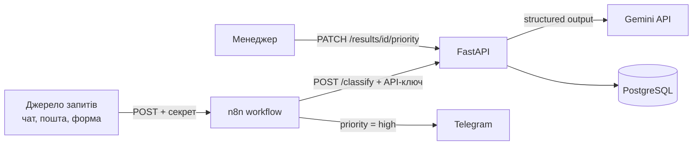

# Request Classifier — AI-сервіс для обробки запитів (FastAPI + PostgreSQL + n8n + AWS)

🇬🇧 [English version](README.md)

Python-сервіс, який приймає запити у вільній формі, класифікує кожен через LLM (Gemini)
у строгу структуру, зберігає результат у PostgreSQL і сповіщає менеджера в Telegram,
якщо запит терміновий. Людина завжди може змінити пріоритет, який поставив AI, а сервіс
рахує, як часто це трапляється.

Проєкт виріс із тестового завдання Netpeak AI Solutions у повноцінний сервіс:
CLI → тести та CI → AWS Lambda → asyncio → Telegram і Google Sheets → FastAPI → PostgreSQL →
Docker Compose → n8n.

## Можливості

- Повертає структурований JSON: категорія, відділ, пріоритет (`low` / `medium` / `high`),
  короткий зміст, потрібні дії, ознака «потрібне уточнення».
- Три способи запуску: **HTTP API** (FastAPI), **пакетна обробка CSV** (`python main.py`) та
  **serverless на AWS** (S3 → Lambda → S3).
- Зберігає результати в PostgreSQL.
- **Human-in-the-loop:** менеджер змінює пріоритет через API. Значення AI не перезаписується,
  зміна фіксується (хто й коли). `GET /stats/overrides` показує частку розбіжностей між людиною та AI.
- **Автоматизація в n8n:** вебхук → класифікація → якщо `high` → повідомлення в Telegram.
- Паралельна обробка (asyncio), реєстр у Google Sheets, повторні спроби з exponential backoff.

## Архітектура



У Docker Compose працюють три сервіси: `db` (PostgreSQL 16), `api` (FastAPI), `n8n`.
Порти відкриті лише на `127.0.0.1`.

## Швидкий старт (Docker Compose)

1. Скопіюй `.env.example` у `.env` і заповни:
   - `GEMINI_API_KEY` — безкоштовний ключ з [aistudio.google.com/apikey](https://aistudio.google.com/apikey)
   - `POSTGRES_PASSWORD` — пароль бази
   - `API_KEY` — довгий випадковий рядок для захисту API
   - `N8N_ENCRYPTION_KEY` — випадковий рядок (збережи копію, без нього credentials n8n не відновити)
   - `N8N_VERSION` — версія n8n (наприклад, `2.47.3`)

   Випадковий рядок: `python -c "import secrets; print(secrets.token_urlsafe(32))"`

2. Запусти:

   ```bash
   docker compose up -d --build
   ```

3. API та документація: <http://127.0.0.1:8000/docs>. Захищені ендпоінти потребують заголовок `X-API-Key`.
4. n8n: <http://127.0.0.1:5678>. Імпортуй `n8n/workflows/classify-and-alert.json`, створи credentials:
   Header Auth для API (`X-API-Key`), Header Auth для вебхука (`X-Webhook-Secret`) та Telegram-бота.

## API

| Метод | Шлях | Опис |
|---|---|---|
| GET | `/health` | Перевірка стану (без ключа) |
| POST | `/classify` | Класифікує запит і зберігає. Повертає аналіз і `record_id` |
| GET | `/results/{id}` | Збережений результат (з `effective_priority`) |
| PATCH | `/results/{id}/priority` | Менеджер змінює пріоритет (аудит: хто й коли) |
| GET | `/stats/overrides` | Скільки результатів переглянуто й змінено (частка розбіжностей) |

Усі ендпоінти, крім `/health`, потребують `X-API-Key`. Якщо `API_KEY` на сервері не задано,
захищені ендпоінти закриті (fail-closed).

```bash
curl -X POST http://127.0.0.1:8000/classify \
  -H "X-API-Key: $API_KEY" -H "Content-Type: application/json" \
  -d '{"id": "REQ-1", "text": "Не працює вивантаження звіту, потрібно полагодити сьогодні", "channel": "Slack"}'
```

## Автоматизація (n8n)

Workflow `n8n/workflows/classify-and-alert.json`:

```
Webhook ──► HTTP Request (POST /classify) ──► IF priority = high ──true──► Telegram
```

- Вебхук захищений секретом у заголовку `X-Webhook-Secret`.
- Запит до API іде за внутрішньою адресою `http://api:8000` (контейнери бачать один одного за іменем сервісу).
- Версія n8n зафіксована, а не `latest`, щоб оновлення не зламало workflow непомітно.

## Дизайн-рішення: зміна пріоритету людиною

- Значення AI (`priority`) ніколи не перезаписується. Рішення менеджера йде в `priority_override`,
  а `overridden_by` і `overridden_at` фіксують, хто й коли.
- Ефективний пріоритет: `COALESCE(priority_override, priority)`. Статистика по `high` рахується за ним.
- Частка розбіжностей (`changed / reviewed`) — зворотний зв'язок для покращення промпта.
- Міграція: `ALTER TABLE ... ADD COLUMN IF NOT EXISTS`, тож стара база оновлюється без втрати даних.

## Пакетна обробка CSV

```bash
pip install -r requirements.txt
python main.py
```

Скрипт читає `input_requests.csv`, обробляє кожен запит і створює:
- `output.json` — повний структурований результат
- `report.md` — короткий звіт з агрегатами

Якщо задано `DATABASE_URL`, результати також зберігаються в PostgreSQL, а в кінець `report.md`
дописується розділ зі SQL-статистикою.

### Запуск у Docker (без Compose)

```bash
docker build -t request-classifier .
docker run --rm --env-file .env -v "$PWD/data:/data" request-classifier
```

(у PowerShell замість `$PWD` використовуй `${PWD}`). Вхідний `input_requests.csv` кладеться в `data/`,
туди ж контейнер пише результати. Секрети передаються через `--env-file` і не потрапляють в образ
(`.env` виключено через `.dockerignore`).

## База даних (PostgreSQL)

```
runs(id, source_file, started_at, total, failed)
  └──< results(id, run_id → runs.id, request_id, channel, category,
               target_department, priority, short_summary, requested_actions (JSONB),
               needs_clarification, processing_status,
               priority_override, overridden_by, overridden_at)
```

- Запуск обробки записується **однією транзакцією**: або всі рядки, або нічого.
- Обмеження: `FOREIGN KEY`, `CHECK` для `priority`, `priority_override`, `processing_status`.
- Запити параметризовані (`%s`), без склеювання рядків.
- Приклади SQL для практики: [`queries.sql`](queries.sql).

## Розгортання на AWS (serverless-конвеєр)

```
CSV  ──►  S3 (input)  ──event .csv──►  Lambda  ──►  Gemini API
                                          │
                                          ▼
                              S3 (output): results/<name>_output.json
                                           results/<name>_report.md
```

Завантаження `*.csv` у вхідний бакет автоматично запускає Lambda (`lambda_handler.py`, Python 3.13).
Вона виконує ту саму логіку, що й `main.py`, і зберігає `*_output.json` та `*_report.md` у вихідний бакет.

| Компонент | Налаштування |
|---|---|
| **S3** | два бакети: вхідний та вихідний |
| **Event notification** | `s3:ObjectCreated:Put/Post` з фільтром суфікса `.csv` → Lambda |
| **Lambda** | Python 3.13, x86_64, handler `lambda_handler.lambda_handler`, збільшені timeout і пам'ять |
| **Змінні середовища** | `GEMINI_API_KEY`, `OUTPUT_BUCKET`; опційно `MAX_CONCURRENCY`, `MAX_REQUESTS_PER_MINUTE`, `TELEGRAM_*`, `GOOGLE_*` |
| **IAM-роль** | мінімальні привілеї: `s3:GetObject` / `s3:ListBucket` на вхідний, `s3:PutObject` на вихідний, логи в CloudWatch |
| **Логи** | CloudWatch Logs |

### Збірка пакета для Lambda

Залежності ставляться для Linux, навіть якщо розробка на Windows:

```bash
pip install -r requirements.txt --target package \
    --platform manylinux2014_x86_64 --only-binary=:all: \
    --python-version 3.13 --implementation cp
```

Скопіюй у `package/` файли `main.py`, `classifier.py`, `schema.py`, `lambda_handler.py`,
`sheets_logger.py`, `telegram_notifier.py` та `db.py` (`main.py` імпортує `db`), заархівуй **вміст**
папки в `deployment.zip` і завантаж у Lambda. У Lambda `DATABASE_URL` не задається, тому запис у базу
там вимкнено.

### Типові проблеми

- **Lambda не запускається після завантаження файлу:** перевір фільтр суфікса в Event notifications.
  Зайвий пробіл (`" .csv"`) вимикає тригер без помилки. Перевірка: `aws s3api get-bucket-notification-configuration`.
- **`API_KEY_INVALID`:** некоректно введений ключ у `GEMINI_API_KEY`.
- **`No module named ...` / `_cffi_backend`:** пакет зібрано під Windows, а не під Linux.
- **Немає групи логів у CloudWatch:** функція ще не викликалась.

> У продакшн-версії ключ варто зберігати в AWS Secrets Manager, а не в змінній середовища.

## Паралельна обробка (asyncio)

`process_all_async()` запускає запити через `asyncio.gather`, а `Semaphore` обмежує кількість
одночасних викликів LLM. Блокуюча `classify_request()` виконується в потоках (`asyncio.to_thread`).
Порядок результатів збігається з порядком у CSV.

| Змінна | За замовчуванням | Призначення |
|---|---|---|
| `MAX_CONCURRENCY` | `3` | скільки запитів до Gemini одночасно |
| `MAX_REQUESTS_PER_MINUTE` | без обмеження | рівномірно розподіляє старти; для безкоштовного тіру (~15 RPM) підійде `12` |

При критичній помилці авторизації нові запити не стартують, а вже оброблені результати зберігаються.

## Telegram-сповіщення (пакетний режим)

Після обробки `telegram_notifier.py` надсилає підсумок і списки по відділах (🔴 high, 🟡 medium,
🟢 low, ⚠️ не вдалося обробити, ❓ потрібне уточнення). Працює і локально, і в Lambda.

| Змінна | Обов'язкова | Призначення |
|---|---|---|
| `TELEGRAM_BOT_TOKEN` | так | токен бота від @BotFather |
| `TELEGRAM_CHAT_ID` | так | основний чат |
| `TELEGRAM_DEPARTMENT_CHATS` | ні | JSON `{"маркетинг": "-100123"}` — окремий чат для відділу |

Якщо токен чи чат не задані, сповіщення тихо пропускаються. Збій Telegram не ламає обробку,
токен у логи не потрапляє. Використовується лише стандартна бібліотека (`urllib`).

## Реєстр у Google Sheets

Кожен запит додається рядком у Google-таблицю (`sheets_logger.py`): час, файл, id, канал,
категорія, відділ, пріоритет, суть, дії, ознаки та колонка «Статус роботи».

- **Спосіб 1: Google Apps Script** (без Google Cloud і ключів). Скрипт [`apps_script/Code.js`](apps_script/Code.js)
  публікується як веб-застосунок і перевіряє секретний токен. Змінні: `GOOGLE_APPS_SCRIPT_URL`,
  `GOOGLE_APPS_SCRIPT_TOKEN`, `GOOGLE_SHEET_TAB`.
- **Спосіб 2: Google Sheets API** (сервісний акаунт). Змінні: `GOOGLE_SHEET_ID`,
  `GOOGLE_SERVICE_ACCOUNT_JSON` або `GOOGLE_SERVICE_ACCOUNT_FILE`, `GOOGLE_SHEET_TAB`.

URL і токен — секрети, у репозиторій їх не комітити. Якщо запис не налаштовано або Google повернув
помилку, конвеєр працює далі. Сумарний розмір змінних середовища Lambda — 4 КБ, а JSON-ключ
займає ~2,5 КБ.

## Тестування та CI

```bash
python -m pytest -v
```

Проєкт покритий **133 автотестами**:

- юніт-тести схеми та обробки помилок;
- інтеграційні тести `classify_request()` з мокованим `genai.Client` (успіх, повний провал, друга спроба);
- тести HTTP API (`tests/test_api.py`): автентифікація, валідація, коди 401/404/422/503;
- наскрізний тест API з реальною базою (`tests/test_api_db.py`);
- тести бази (`tests/test_db.py`): транзакції, `FOREIGN KEY`, `CHECK`, аудит зміни пріоритету, міграція;
- тести Google Sheets, Telegram, паралельної обробки.

Тести бази використовують `TEST_DATABASE_URL` і тимчасову схему, тож не чіпають реальні дані.
Без цієї змінної вони пропускаються.

**GitHub Actions** на кожен pull request і push у `main` запускає `ruff`, `pytest` з контейнером
PostgreSQL і збірку Docker-образу ([`ci.yml`](.github/workflows/ci.yml)).

## Структура виводу LLM

Обов'язкові поля: `id`, `category`, `target_department`, `priority`, `short_summary`,
`requested_actions`, `needs_clarification`. Розширення: `processing_status` (`ok` / `failed`).
Кожен запит, який не вдалося обробити після повторних спроб, все одно потрапляє у результат зі
статусом `failed`, тож проблемні запити не губляться.

`target_department` — це `str = ""`, а не `Optional[str]`: обхід реальної несумісності між
Pydantic `Optional` та structured output в `google-genai` (`literal_error` для типу `NULL`).

## Обмеження та де рішення ламається

- **Невалідний вивід LLM:** до 3 повторних спроб з exponential backoff (3с → 6с → 12с → 24с),
  далі `processing_status: "failed"`.
- **Нестабільність версій моделей:** використовуються aliases (`gemini-flash-lite-latest`,
  `gemini-flash-latest`), які Google сам оновлює. Для rate limit сервіс чекає точний час, який
  радить Google (`parse_retry_delay()`).
- **Квоти:** безкоштовний тір Gemini має денний і хвилинний ліміти. Для великих обсягів потрібен
  Batch API чи платний тір. У Lambda максимум 15 хвилин на виклик, для великих файлів потрібне
  розбиття на чанки (наприклад, SQS).
- **Недетермінізм:** `temperature=0` зменшує, але не усуває варіативність.
- **API:** немає дедуплікації запитів (кожен запит → окремий запис). Схема бази оновлюється через
  `ALTER ... IF NOT EXISTS`, у майбутньому це місце для Alembic.

## Що далі

1. Кнопки в Telegram для зміни пріоритету одним натисканням (потрібен публічний HTTPS-тунель).
2. AI-агент із tool calling (пошук схожих запитів, ескалація).
3. RAG по історії запитів і evaluation-набір для промптів.
4. Infrastructure as Code (AWS SAM або Terraform), dead-letter queue та алерти для Lambda.
5. Alembic-міграції.

## Структура проєкту

```
netpeak-ai-request-classifier/
├── .github/workflows/ci.yml     # CI: ruff + pytest (PostgreSQL) + docker build
├── api.py                       # FastAPI: /classify, /results, /stats/overrides
├── main.py                      # пакетна обробка: CSV -> LLM -> output.json + report.md
├── classifier.py                # виклик Gemini, retry-логіка, логування
├── db.py                        # PostgreSQL: збереження, зміна пріоритету, статистика
├── schema.py                    # Pydantic-схема виводу
├── lambda_handler.py            # AWS Lambda: S3-подія -> класифікація -> S3
├── sheets_logger.py             # реєстр у Google Sheets
├── telegram_notifier.py         # Telegram-сповіщення (пакетний режим)
├── apps_script/Code.js          # скрипт для таблиці (запис через Apps Script)
├── queries.sql                  # приклади SQL-запитів
├── n8n/workflows/               # експортовані workflow n8n
├── tests/                       # 133 тести (conftest.py, test_api*.py, test_db.py, ...)
├── docker-compose.yml           # db + api + n8n
├── Dockerfile
├── .dockerignore
├── .env.example
├── pyproject.toml
├── requirements.txt
└── README.md / README.uk.md
```
